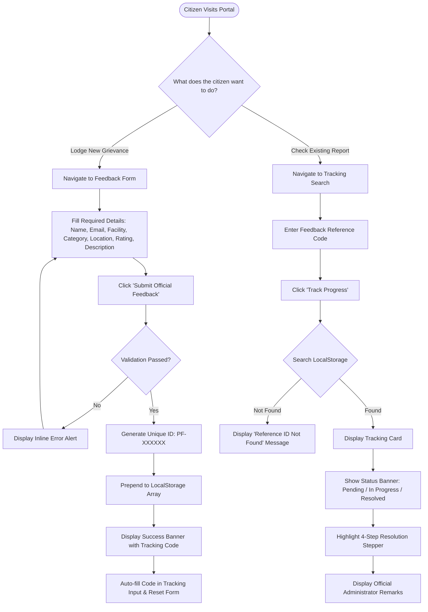
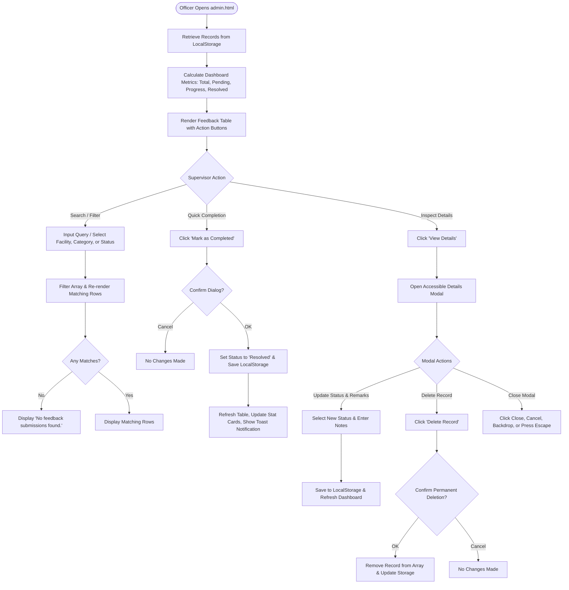
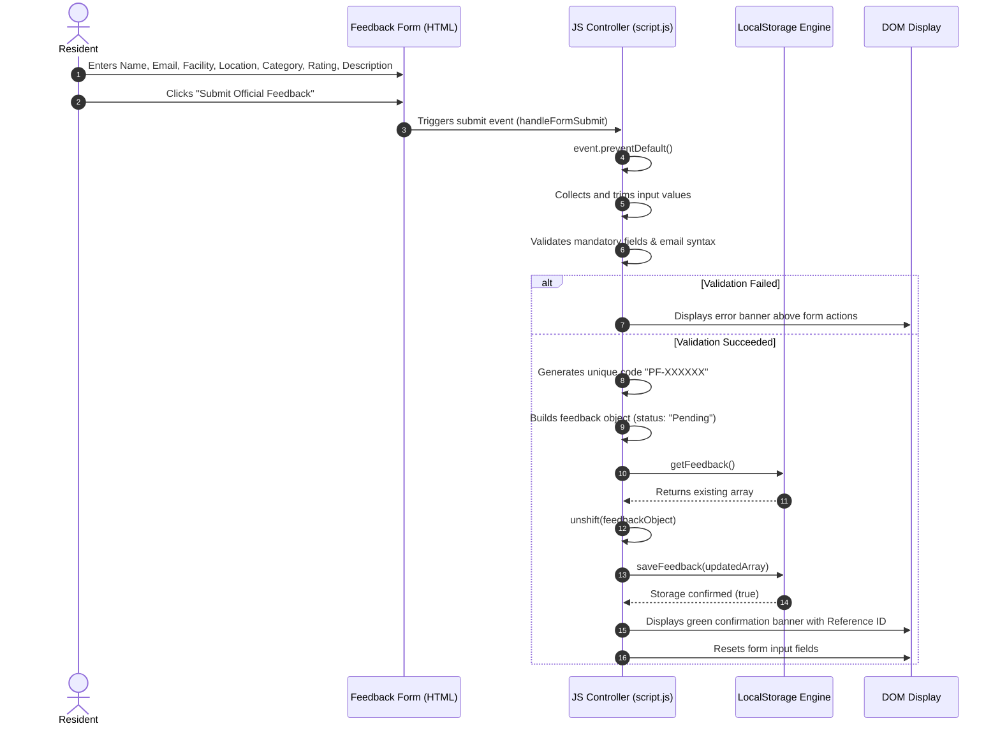
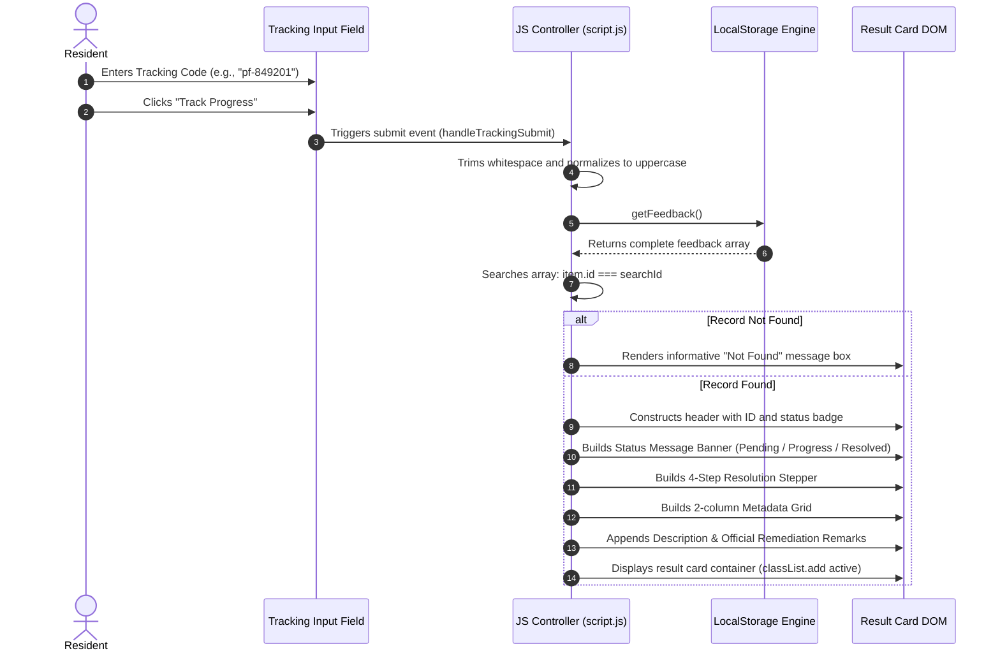
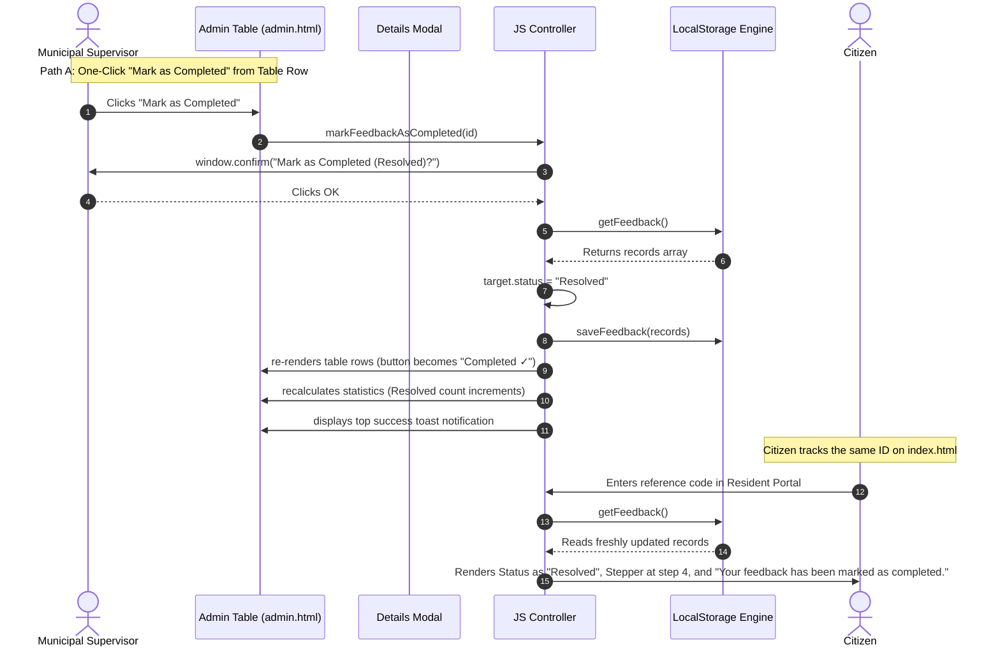

# Public Facility Feedback System (Public Voice)
## System Architecture & Workflow Specifications

---

### Table of Contents
1. [Architectural Overview](#1-architectural-overview)
2. [High-Level System Architecture Diagram](#2-high-level-system-architecture-diagram)
3. [Resident Portal Workflow](#3-resident-portal-workflow)
4. [Admin Dashboard Workflow](#4-admin-dashboard-workflow)
5. [Feedback Submission Sequence Flow](#5-feedback-submission-sequence-flow)
6. [Feedback Tracking Sequence Flow](#6-feedback-tracking-sequence-flow)
7. [Status Update & Completion Workflow](#7-status-update--completion-workflow)
8. [LocalStorage Data Flow & Lifecycle](#8-localstorage-data-flow--lifecycle)
9. [Component Relationship & State Diagram](#9-component-relationship--state-diagram)

---

### 1. Architectural Overview

The **Public Facility Feedback System (Public Voice)** employs a **Single-Origin Client-Side Web Architecture**. 

Because it operates completely without a back-end server or external database, all core components—presentation, business logic, validation, and data persistence—execute entirely inside the user's web browser:

1. **Presentation Layer (View):** Semantic HTML5 pages (`index.html` and `admin.html`) styled by a unified, responsive CSS3 design system (`css/style.css`).
2. **Controller & Business Logic Layer:** A native Vanilla JavaScript engine (`js/script.js`) managing DOM manipulation, user event handling, validation algorithms, array filtering, and security sanitation.
3. **Storage & Persistence Layer (Model):** The browser's native `LocalStorage` subsystem using JSON serialization (`JSON.stringify` and `JSON.parse`) keyed under `'publicVoiceFeedback'`.

---

### 2. High-Level System Architecture Diagram

```mermaid
flowchart TD
    subgraph ClientBrowser["Client Web Browser (Chrome / Edge / Firefox / Safari)"]
        subgraph Views["Presentation Views (HTML5 & CSS3)"]
            RP["Resident Portal (index.html)"]
            AP["Admin Dashboard (admin.html)"]
        end

        subgraph Controller["Application Controller (js/script.js)"]
            Init["Page Initializer (init)"]
            Val["Form Validation Engine"]
            IDGen["ID Generator (PF-XXXXXX)"]
            TrackEng["Tracking & Stepper Engine"]
            FilterEng["Search & Multi-Filter Engine"]
            MetricEng["Statistics Counter Engine"]
            ModalEng["Details Modal Controller"]
            CompEng["Mark as Completed Controller"]
        end

        subgraph StorageLayer["Browser Local Storage Subsystem"]
            LS[("LocalStorage Engine: 'publicVoiceFeedback'")]
        end
    end

    RP -->|"Form Input / Search Query"| Controller
    AP -->|"Filters / Status Updates / Deletions"| Controller
    Controller -->|"Safe DOM Updates (textContent)"| Views
    Controller <-->|"Read (getItem) & Write (setItem)"| StorageLayer
```



---

### 3. Resident Portal Workflow

The Resident Portal prioritizes zero-friction public service:



---

### 4. Admin Dashboard Workflow

The Admin Dashboard empowers municipal supervisors to review and resolve civic grievances:



---

### 5. Feedback Submission Sequence Flow



---

### 6. Feedback Tracking Sequence Flow



---

### 7. Status Update & Completion Workflow



---

### 8. LocalStorage Data Flow & Lifecycle

The application relies on a single storage key (`publicVoiceFeedback`). All records follow a structured, predictable lifecycle:

```
[ New Submission ] ---> unshift() ---> [ Stored Array in LocalStorage ]
                                                  |
           +--------------------------------------+--------------------------------------+
           |                                      |                                      |
           v                                      v                                      v
    [ Read by Admin ]                     [ Read by Resident ]                   [ Delete Record ]
    - Overview Metrics                    - Progress Stepper                     - Filtered out
    - Table Listing                       - Status Indicator                     - Array saved
    - Details Modal                       - Official Remarks                     - Record removed
           |
           v
    [ Status Update / Completed ]
    - Status: "Resolved"
    - Admin remarks added
    - saveFeedback() persists
```

---

### 9. Component Relationship & State Diagram

```mermaid
stateDiagram-v2
    [*] --> Submitted: Resident Submits Form (ID Generated)
    
    state Submitted {
        [*] --> Pending: Stored in LocalStorage
        Pending: "Your feedback has been received and is awaiting review."
        Pending: Step 1 Active
    }

    Pending --> UnderReview: Officer opens Details Modal / Assigns Crew
    UnderReview: Status: Under Review
    UnderReview: Step 2 Active

    UnderReview --> InProgress: Work Squad Dispatched
    Pending --> InProgress: Direct Status Change
    
    state InProgress {
        InProgress: "Your feedback is currently being addressed."
        InProgress: Step 3 Active
    }

    InProgress --> Resolved: Supervisor clicks "Mark as Completed"
    Pending --> Resolved: Immediate Resolution
    
    state Resolved {
        Resolved: "Your feedback has been marked as completed."
        Resolved: Step 4 Active (All Steps Checked)
        Resolved: Action Button Disabled ("Completed ✓")
    }

    Resolved --> [*]: Lifecycle Closed
```

